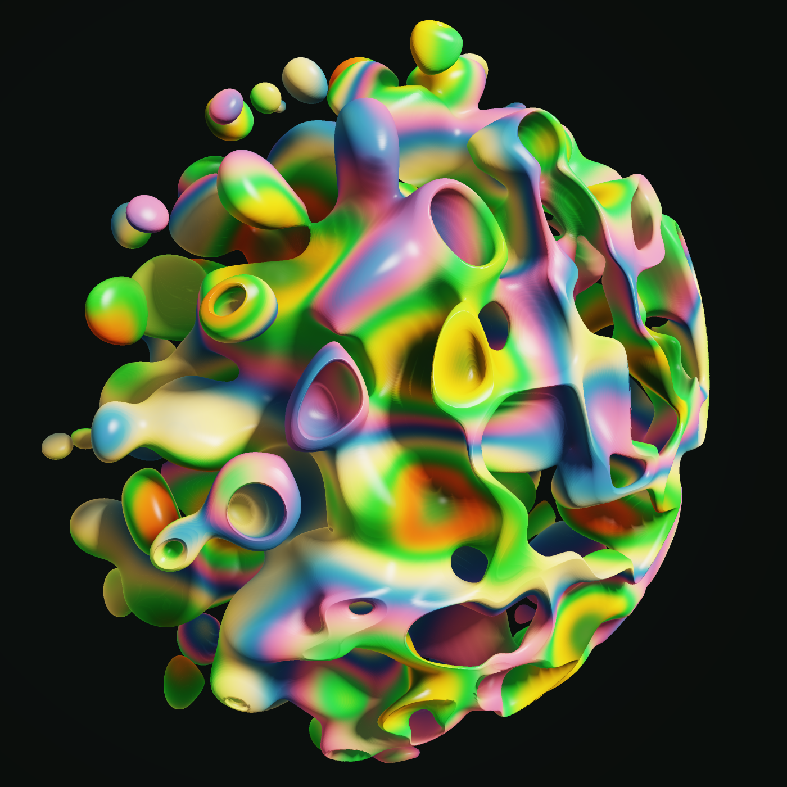

# Consculpta

Interactive evolution of 3D sculptures from formulas over simplex noise, raymarched in WebGL 2.

<p align="center"></p>

- **Live site:** https://carlok.github.io/consculpta/
- **Licence:** [Apache-2.0](LICENSE)

## About

Each sculpture is the region where a formula over [3D simplex noise](https://en.wikipedia.org/wiki/Simplex_noise) rises above an [iso level](https://en.wikipedia.org/wiki/Isosurface) inside a sphere, cube or drum. Formulas are trees of noise, trigonometry and space transforms (twist, mirror, rotate, warp). Every offspring changes its parent's tree by tweaking a number, swapping a function, grafting a new branch, wrapping a node or cutting one out. About one offspring in twelve switches to strands: thin filaments traced where the formula's surface crosses a rotated copy of itself. The page evaluates each formula on 520 sample points to normalise it, estimate a safe [raymarching](https://iquilezles.org/articles/raymarchingdf/) step and throw out empty or solid results before anything is compiled.

[Simplex noise](https://github.com/stegu/webgl-noise) by Ian McEwan, Ashima Arts and Stefan Gustavson ([MIT](https://opensource.org/license/MIT)). Colours use Inigo Quilez's [cosine palettes](https://iquilezles.org/articles/palettes/). Shader code exports a standalone [Shadertoy](https://www.shadertoy.com/) shader with the formula compiled in.

## How to use

Open the [live site](https://carlok.github.io/consculpta/) in a WebGL 2 browser. The main stage shows the current parent specimen; drag to orbit and scroll to zoom.

1. **Breed** — Each litter has six offspring. Click one to adopt it as the new parent (generation counter increases). Use **New litter** to regenerate the litter without changing the parent, or adjust **Mutation** and breed again after adopting.
2. **Kept specimens** — Press **Keep** to pin the current parent on the shelf. When the shelf is non-empty, some offspring crossbreed with a kept formula.
3. **Genome** — Open the genome panel to edit the formula, scalars, and palette, or paste a genome code and **Load**.
4. **Export** — **Shader code** opens a sheet with a Shadertoy-ready GLSL export; **Snapshot** renders a high-resolution PNG from the current camera.
5. **Large view** — On wide screens, **Large view** toggles a wider main stage versus giving the litter grid more room in the layout. Your choice is stored in this browser (`localStorage` key `nsb.big`).
6. **AI breeder** (optional) — Off by default. Turn it on to let a configured model rank litters or suggest offspring. You choose the provider (Anthropic API or an OpenAI-compatible endpoint), model, and API key in the settings panel.

## Privacy and API keys

Consculpta has **no backend**. The app runs entirely in your browser.

- **API keys** live in page memory while you use the site. They are written to `localStorage` only if you tick **Remember the key on this device** (`nsb.keys`); otherwise they are cleared when you leave or reload.
- **Requests** go **directly** from your browser to the endpoint you configure (Anthropic API or an OpenAI-compatible base URL). Keys are not sent to the Consculpta repository, GitHub Pages, or any project server.
- **Logging** — The app does not log API keys or model responses to a remote service. Provider traffic is between you and that provider under their terms.

Other preferences (genome, shelf, mutation rate, layout, AI settings without keys) may be stored locally under `nsb.v3`, `nsb.ai`, and related keys so you can resume a session.

## Development

```bash
npm ci
npm run check    # lint, typecheck, unit tests, e2e (CI)
npm run dev      # Vite dev server (refactored shell under src/)
npm run build:engine   # refresh legacy/engine.bundle.js for the live page
```

The Pages deployment serves root `index.html`, `legacy/`, and vendored assets. See [docs/DECISIONS.md](docs/DECISIONS.md) for maintainer decisions.

---

© 2026 carlok
